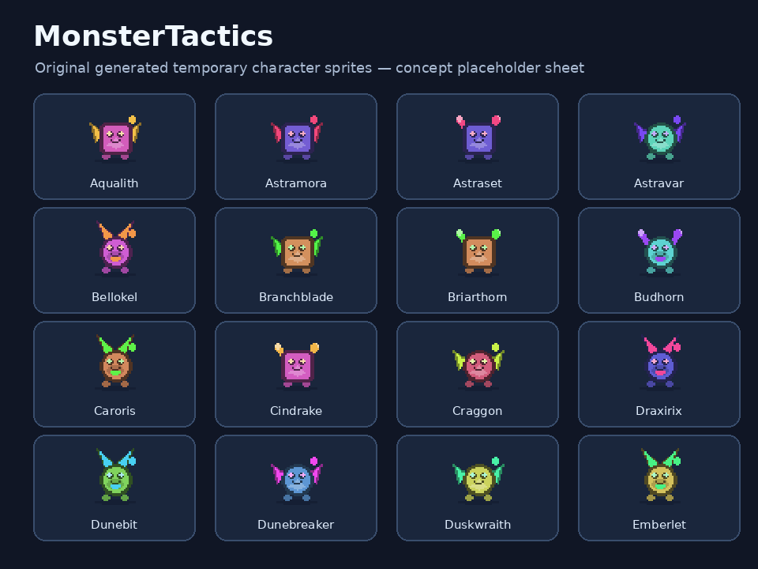

# MonsterTactics

**A 2.5D tactical auto-battler built with Unity 6 and C#.**

This is a portfolio-oriented copy of a personal strategy-game project, developed first as a React + TypeScript + Phaser prototype and subsequently rebuilt in Unity. It features automatic combat on a hex board, character progression, team synergies, abilities, game economy, items, and data-driven balance systems.

> **Portfolio placeholder build.** All PNG art was replaced with **new, original, procedurally drawn temporary graphics**, and the four imported character model files were replaced with generated, non-rigged training avatars. Character names and code identifiers were systematically rebranded. **This package has not been imported, compiled, or play-tested inside Unity after the replacements.** Expect to retarget 3D animations, adjust sprites, and fix any resulting scene references before distributing a working game build.

## Technologies

- Unity Editor **6000.6.6f1** (Unity 6), **C#**
- Prior web prototype: React, TypeScript, Phaser (not included in this Unity export)
- Custom gameplay architecture, editor tools, and sprite-frame animation

## Implemented systems in the source project

- Automated hex-grid battles, target selection, combat stats, and ability effects
- Character evolution / stars, traits, and unit-based team composition
- Gold economy, leveling, probability-based shop, round progression
- Equipment crafting, inventory, item bonuses, and loot
- Augments, PvE encounters, balancing and content editing tools
- 2D sprite animations, VFX, character and UI systems

## Opening in Unity

1. Extract the repository, keeping `Assets/`, `Packages/`, and `ProjectSettings/` in the same project root.
2. In Unity Hub choose **Add project from disk** and select this root folder.
3. Open with the matching Unity Editor version **6000.6.6f1** (or let Unity upgrade the project, keeping a backup).
4. Open `Assets/Scenes/SampleScene.unity`, inspect Console errors, and resolve any broken 3D model/animation references before attempting the Play button.
5. Review scripts and generated art before sharing a playable build. The original trainers' proprietary 3D rigs and animations are **not** bundled.

## Important limitations

- The graphic replacements were performed **outside Unity**, so runtime behavior and exact on-screen appearance are **not verified**.
- Sprite files keep their original dimensions and existing `.meta` files / GUIDs where possible; this is meant to preserve source references, not guarantee presentation accuracy.
- Replaced 3D models are **static COLLADA training dummies** without the original armatures or clips; original trainer animation controllers may need rebuilding.
- Some historical editor utilities may still expect specific imported rig configurations.
- Names, display labels, source paths, and C# identifiers have been migrated automatically and may need manual code review.
- Core artwork shown here consists of intentionally simple placeholders; replace with custom final art before releasing the game.
- A public repository is not the same as an authorization or guarantee to publish every component. Review the code, dependencies, and all remaining licensing obligations before making it public.

See [Portfolio conversion audit](docs/CONVERSION_AUDIT.md) for the full static validation notes.

## GitHub

Using GitHub Desktop: **File → Add local repository** → choose this project root → if necessary choose **Create a repository here** → commit → **Publish repository**. Keep it **private** until you have imported the project in Unity and manually checked it.

**Project:** MonsterTactics — 2.5D Tactical Auto-Battler  
**Topics:** `unity`, `csharp`, `hex-grid`, `auto-battler`, `game-development`, `procedural-placeholder-art`.

## Code and asset ownership

This export is provided as a private portfolio working copy. No blanket open-source license is granted by this package. Unity and other dependencies remain subject to their respective terms. See [art policy](docs/ASSET_POLICY.md).
